**Dois engenheiros. Do pixel ao servidor.**  
**Two engineers. From pixel to server.**

[Site](https://axiumhq.dev) · [Vortex](https://github.com/axiumhq/vortex) · [Jukejoint](https://github.com/axiumhq/jukejoint)

---

Somos Vinicius e Enzo, dois engenheiros. Projetamos, programamos, hospedamos e operamos software. Cada camada, com as mesmas mãos.

## Projetos públicos

**[Vortex](https://github.com/axiumhq/vortex)** é um chat self-hosted com cliente web e desktop, servidor próprio, voz e compartilhamento de tela. Usa o protocolo Stoat e é distribuído sob a licença AGPL-3.0. O projeto é independente e não é afiliado ao Stoat.

**[Jukejoint](https://github.com/axiumhq/jukejoint)** reúne jogadores de Deadlock em lobbies para modos personalizados, pelo site ou aplicativo Windows. O código é público para consulta, mas tem licença proprietária; não é uma licença de código aberto.

---

We are Vinicius and Enzo, two engineers. We design, code, host and run software. Every layer, with the same hands.

## Public projects

**[Vortex](https://github.com/axiumhq/vortex)** is a self-hosted chat with web and desktop clients, its own server, voice, and screen sharing. It uses the Stoat protocol and is released under AGPL-3.0. Vortex is independent and is not affiliated with Stoat.

**[Jukejoint](https://github.com/axiumhq/jukejoint)** brings Deadlock players together in custom-mode lobbies through its website or Windows app. Its source is publicly viewable but proprietary-licensed, not open source.
